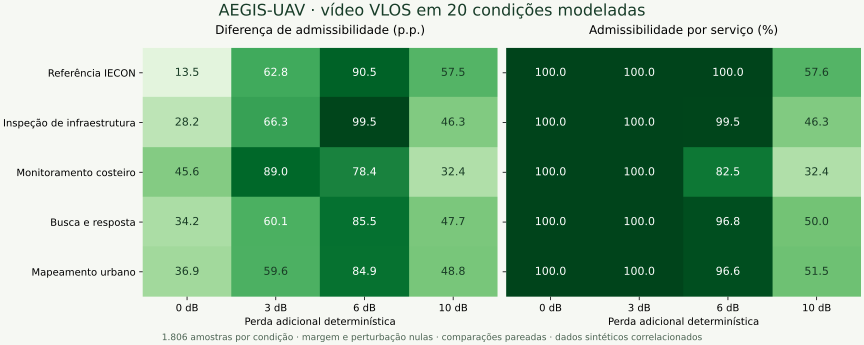

# AEGIS-UAV
### Requisitos de missão. Decisões de comunicação explicáveis.

O **AEGIS-UAV** é um ambiente de pesquisa e apoio ao planejamento de comunicações UAV. Ele traduz requisitos de controle e vídeo em critérios de admissibilidade de taxa, compara políticas sob o mesmo sinal e torna cada decisão inspecionável.

[**Abrir aplicação**](https://whatisthetimeac.github.io/AEGIS-UAV/) · [**Método e contribuição**](docs/CONTRIBUICAO_E_VALIDACAO.md) · [**Dados do estudo**](data/study_20_scenarios.csv) · [**Execução MATLAB**](matlab/README.md)

## A pergunta que orienta o projeto

**Quando um enlace deixa de atender ao vídeo mais exigente, quais outros serviços continuam admissíveis pelo requisito de taxa?**

C2 por waypoints requer 0,8 kbit/s no perfil adotado; vídeo N-VLOS requer 4 Mbit/s. Aplicar o limiar do serviço mais exigente a todos os perfis pode ocultar essa diferença. O AEGIS-UAV explicita o requisito, o nível da abstração de enlace e a decisão resultante. Isso apoia a comparação técnica de critérios para inspeção de infraestrutura, monitoramento e missões com tráfego heterogêneo.

## Evidência de referência

A base de pesquisa é o estudo **“From Uniform Thresholds to Service-Aware Link Admission in UAV Missions: A Reproducible MATLAB Study”**, aceito no IECON 2026. A comparação mantém potência, banda, geometria e SNR constantes entre as políticas.

| Cenário principal, SNR contínuo | Resultado |
|---|---:|
| Trajetórias modeladas × instantes | 6 × 301 |
| Avaliações de enlace-posição | 1.806 |
| Admissões pelo limiar uniforme de 14,1 dB | 1.562 (86,49%) |
| Admissões por perfil menos exigente | 1.806 (100,00%) |
| Diferença por perfil menos exigente | **+13,51 p.p.** |
| Rejeições conservadoras evitadas por perfil menos exigente | **244** |
| Diferença para vídeo N-VLOS, controle negativo | **0,00 p.p.** |

A contribuição é a **classificação consistente com o requisito de cada serviço**, quantificada sob as hipóteses registradas. O limiar uniforme é um controle deliberadamente conservador. O método não pressupõe que esse seja o comportamento de todas as redes existentes. O sinal físico e os recursos de rádio permanecem os mesmos.

## Explore a aplicação

- **Mapa de missão:** cartografia OpenStreetMap, drones com orientação de movimento, seleção de aeronaves e planejamento com waypoints numerados.
- **Laboratório de decisão:** inspeção por instante, perda adicional, margem, perturbação de limiar e comparação com o diagnóstico de arredondamento legado.
- **Análise da missão completa:** contagens por serviço, diferença em pontos percentuais, distribuição por trajetória e matriz de sensibilidade.
- **Estudo em lote:** quatro missões sintéticas e a referência IECON, cruzadas com quatro perdas adicionais; 20 condições e 80 linhas de resultados por perfil.
- **Rastreabilidade:** cadeia taxa → eficiência espectral → nível → limiar, registros JSON, decisões CSV e planejamento GeoJSON.
- **Fluxo MATLAB:** geração de trajetórias, reanálise da referência e execução local integrada, quando o runtime está instalado.

O botão **Demonstração guiada** seleciona um ponto existente na base em que os critérios diferem. Os resultados completos permanecem disponíveis, incluindo trajetórias e serviços sem ganho.

## Estudo multicontexto



A figura apresenta a diferença entre políticas junto da admissibilidade absoluta. Assim, um ganho relativo ao controle pode ser interpretado com o nível de atendimento do próprio serviço. As missões adicionais são exercícios modelados, separados da evidência de referência do artigo. Os resultados registrados foram calculados pelo motor JavaScript em Node.js; o registro de proveniência informa o ambiente de execução.

[CSV completo](data/study_20_scenarios.csv) · [Proveniência](data/study_provenance.json) · [Figura vetorial](docs/figures/study_vlos.svg)

## Executar

Para explorar a aplicação, abra o [site](https://whatisthetimeac.github.io/AEGIS-UAV/) ou o `index.html` baixado. A análise funciona localmente; o mapa online depende de conexão. Sem o provedor cartográfico, há um plano XY esquemático.

Para servir a aplicação e habilitar o MATLAB instalado no computador:

```bash
python3 scripts/serve_matlab.py
```

Abra `http://127.0.0.1:8765`. Se MATLAB estiver fora do PATH, defina `MATLAB_BIN` com o caminho do executável antes de iniciar. O botão **Executar missão no MATLAB** envia o planejamento sintético atual ao simulador local e importa o CSV produzido. O site estático usa importação CSV; a execução MATLAB ocorre no computador que executa o iniciador.

Para gerar todo o estudo diretamente no MATLAB, a partir da raiz do repositório:

```matlab
addpath('matlab'); run_aegis_study('aegis_study');
```

## Reproduzir a análise e verificar o código

```bash
node tests/test_core.cjs --export
python3 tests/test_bridge.py
python3 scripts/build.py
```

O primeiro comando verifica a base e gera os resultados das 20 condições. `scripts/plot_study.py` recria a figura com Python, NumPy e Matplotlib. `src/` contém o código modular; `scripts/build.py` gera o `index.html` portátil para publicação.

## Interpretação e extensão

A unidade de análise é uma amostra de enlace-posição. As amostras são temporalmente correlacionadas e as comparações são descritivas. A admissão de cada perfil é avaliada individualmente, sem reservar capacidade agregada para tráfego simultâneo. Cartografia real contextualiza a visualização; trajetórias e âncoras geográficas são modeladas. Os dados não estabelecem entrega de pacotes, latência, confiabilidade de voo ou cobertura de um local físico.

O [protocolo de validação](docs/CONTRIBUICAO_E_VALIDACAO.md) define a evolução para séries medidas independentes, calibração do canal e experimentos de rede e missão.

## Autoria e fontes

**Ana Clara da Silva Teixeira · Instituto Militar de Engenharia.** Proponente e responsável pela demonstração AEGIS-UAV. A pesquisa IECON de origem é coautorada; seus créditos permanecem preservados. AEGIS-UAV e SkyMesh são projetos distintos.

Perfis de serviço: 3GPP TS 22.125 V19.2.0, conforme o manuscrito. Abstração SNR–eficiência espectral: tabela de 15 níveis do framework de referência documentado no estudo. Geometria: [proveniência da base](data/iecon_replay_provenance.json). Cartografia: © [OpenStreetMap contributors](https://www.openstreetmap.org/copyright). Dados e componentes de terceiros mantêm suas respectivas condições de uso.
